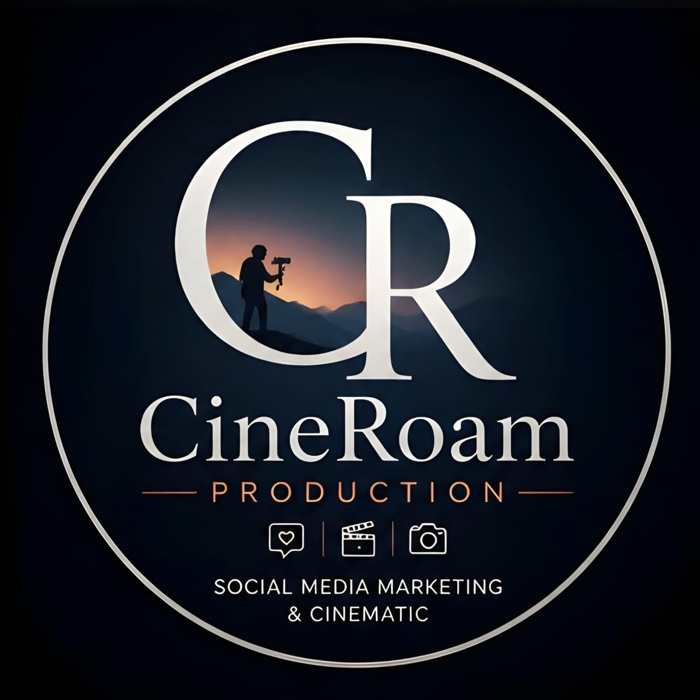

# CineRoam Production — Chandan Mahato Portfolio

Official commercial portfolio and cinematic showcase for **Chandan Mahato**, Director of Photography, Commercial Photographer, and Founder of **CineRoam Production**.



## 🎬 Capabilities & Focus
- **Cinematography & Brand Films**: 4K/6K cinema camera capture, DaVinci Resolve color science (S-Log3 / ACES), gimbal tracking passes, and high-fidelity sound design.
- **Gourmet Food & Culinary Photography**: Chiaroscuro lighting, textured surfaces, macro ingredient detail, and packaging imagery.
- **Commercial & E-Commerce Product Shoots**: Luxury cosmetics (e.g. Mesaura Skincare), white-background catalog shots, and Amazon A+ lifestyle banners.
- **Social Media Marketing & Viral Reels**: High-retention 9:16 vertical video sequences engineered for Instagram and YouTube algorithms.

## 🛠️ Tech Stack
- **Framework**: React 19 + Vite 6
- **Styling**: Tailwind CSS + Custom Dark Theme
- **Typography**: *Bricolage Grotesque*, *Cormorant Garamond*, *JetBrains Mono*, *Schibsted Grotesk*
- **Icons**: Lucide Icons & Custom SVG Vectors
- **Interactive Features**:
  - Live Camera HUD & Viewfinder Switcher
  - Fullscreen EXIF & Lighting Lightbox Inspector
  - Before & After DaVinci Resolve Color Grading Slider
  - Interactive Project Investment & Scope Estimator with instant WhatsApp brief generator
  - Web Audio API Mechanical Shutter Sound FX

## 🚀 Development

```bash
# Install dependencies
npm install

# Run local development server
npm run dev

# Build for production
npm run build

# Preview production build
npm run preview
```

## 📄 License
© 2026 Chandan Mahato (CineRoam Production). All rights reserved.
